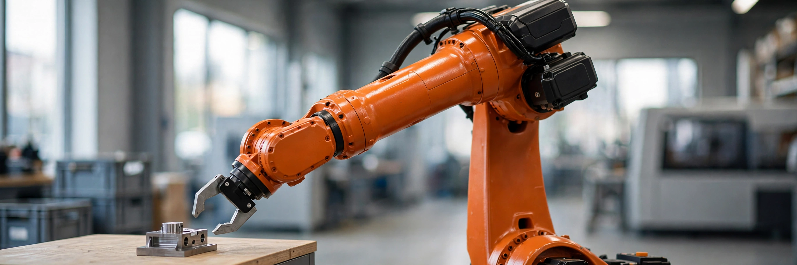

<div align="center">

# 🤖 Robot Skills Library



**Robot-Skills makes your AI better at writing RAPID.**


[](LICENSE)
[](https://agentskills.io)
[](https://skills.sh)
[](#install-in-3-steps)

[🚀 Install in 3 steps](#install-in-3-steps) · [📖 Beginner roadmap](docs/beginner-roadmap.md) · [⚡ Cheat sheet](docs/cheatsheet.md) · [🔍 Comparison](docs/comparison.md)

</div>

> 中文版见 [README.md](README.md) (Chinese version).

| Write code | Simulate | Smart Components | Keep learning |
|---|---|---|---|
| RAPID, correct and fast, 10 routines to practice with | Run it in a virtual controller first, check collisions, then go to the real robot | Build a station in 6 stages, modeling and components included | Every question is recorded, the skills grow with each question |

Chinese, step by step, complete runnable code with each important part explained. Goal: Python + PLC + ABB robots working together for industrial automation.

## 🗺️ Capability map: what you want to do, where to look

| You want to | Open | You get |
|---|---|---|
| Write RAPID code | `skill/robot-rapid/references/rapid-patterns.md` + `rapid/` | 9 common patterns, copy and change the positions |
| Program errors / won't run | `skill/robot-rapid/references/troubleshooting.md` | Error lookup table, locate first, then fix |
| Build Smart Components | `skill/robot-rapid/references/smart-components.md` | Step by step, signals, logic, and actions explained |
| Simulate / check before real hardware | `skill/robot-rapid/references/simulation-checklist.md` | Checklist, don't go to the real robot until all boxes are ticked |
| Build a station from 0 to 1 | `docs/full-pipeline.md` | Full 6-stage flow, click through it |
| Where a beginner starts | `docs/beginner-roadmap.md` | 12-lesson roadmap + 6 common mistakes |
| Control the robot with Python | `python/01_move_joints.py` | Print the RAPID first, check it, then run it |
| Write Python code | `python/README.md` | How to use Python with the robot: setup, two examples, the safe workflow |
| Questions asked before | `skill/robot-rapid/references/learned.md` | Question → answer → why, ready to use |

---

## ✨ What the skill does

One skill lives in this repo: **Robot-RAPID** (folder `robot-rapid`).

Install it, and your assistant teaches you the ABB way:

1. **Write RAPID code**: MoveJ / MoveL / MoveAbsJ, IO, loops, coordinate systems, arcs, error handling, 10 routines to practice with.
2. **Build a station from 0 to 1**: station → robot → teach pendant → modeling → Smart Components → programming, 6 stages step by step.
3. **Simulate first, real robot second**: every program runs in a RobotStudio virtual controller and passes a collision check before low-speed manual validation on hardware.
4. **Python can drive the robot too**: send commands with `abb_motion_program_exec`, print the RAPID first, check it, then run it.
5. **It keeps learning**: every question you ask is recorded and the skill grows a little, so the library and the skill grow together.

> Not an official ABB tutorial. A teaching version rewritten from official syntax and the consensus of several beginner tutorials. Positions are teaching values; reteach them before running on real hardware.

---

## 🚀 Install in 3 steps

**Step 1: one command to install a skill (recommended, same as other skills)**

```bash
npx skills add linxie654-netizen/Robot-Skills
```

Requires Node.js 22.20 or newer. The command finds the skills in the repo and asks which assistant to install to (verified: Claude Code). Install was tested 2026-11-20 under the previous repo name; the repo was renamed on 2026-11-22 (old address redirects), re-test with the new name is pending.

**Step 2: prefer manual install?**

Clone the repo:

```bash
git clone https://github.com/linxie654-netizen/Robot-Skills.git
```

No git? Open the link above, click the green `Code` → `Download ZIP`, and unzip. Then copy the skill into your assistant:

| Your assistant | Copy command |
|---|---|
| Muse | `cp -r Robot-Skills/skill/robot-rapid ~/workspace/custom-skills/robot-rapid` |
| Claude Code | `cp -r Robot-Skills/skill/robot-rapid ~/.claude/skills/robot-rapid` |
| Other assistants | Send the full text of `skill/robot-rapid/SKILL.md` to it, or save it in a skill directory it supports |

**Step 3: ask your first question**

Ask in your assistant, for example:

> I'm a beginner, where do I start learning ABB?

It will follow the skill and start you on `rapid/01_move_basics.mod`.

**To run simulations you also need RobotStudio**: free download from [ABB's website](https://new.abb.com/products/robotics/robotstudio/downloads). Build a station with `robotstudio/tutorial.md`. No robot model decided yet? Practice with IRB 120 first.

---

## 📂 Directory

- `rapid/` — RAPID teaching routines (rewritten from official syntax, not copied)
  - `01_move_basics.mod` — MoveJ / MoveL / MoveAbsJ basics
  - `02_pick_place.mod` — Pick and place, gripper IO
  - `03_io_signals.mod` — Digital IO, waiting for signals, SetDO / WaitDI
  - `04_loops_conditions.mod` — IF, FOR, WHILE, counting
  - `05_coordinates.mod` — Tool tooldata, work object wobjdata, frames
  - `06_joint_move.mod` — J1–J6 joint motion, jointtarget
  - `07_move_circle.mod` — MoveC arcs
  - `08_test_case_functions.mod` — TEST/CASE + FUNC return values
  - `09_error_handling.mod` — ERROR handling, RAISE
  - `10_analog_io_wait.mod` — Analog IO, WaitUntil
- `python/` — Python-to-robot examples (using `abb_motion_program_exec`)
  - `01_move_joints.py` — Python sends MoveAbsJ
  - `02_pick_place.py` — Python sends MoveJ/MoveL pick and place
  - `requirements.txt` — `abb-motion-program-exec`
  - `README.md` — How to use Python with the robot
- `robotstudio/` — RobotStudio tutorial
  - `tutorial.md` — Build a station, pick a robot, virtual controller, teaching, simulation, step by step
- `docs/` — Cheat sheets and comparisons
  - `beginner-roadmap.md` — 12-lesson beginner roadmap (consensus of online tutorials)
  - `cheatsheet.md` — RAPID cheat sheet
  - `comparison.md` — Comparison table of online apps and libraries
  - `full-pipeline.md` — 0-to-1 pipeline in 6 stages (Skill version)
- `skill/robot-rapid/` — ABB skill Robot-RAPID
  - `SKILL.md` — Skill text (RAPID, 0-to-1 pipeline)
  - `INSTALL.md` — Install guide (Muse / Claude Code / other assistants)
  - `skill.yaml` — Skill metadata
  - `references/` — Learned lessons, error handbook, common patterns, Smart Components, simulation checklist
- `learning-log.md` — Record of every question asked, kept up to date
- `vendor/` — Reference sources pulled in for study (other people's projects, original repos and licenses kept)
  - `abb_motion_program_exec/` — rpiRobotics, Apache-2.0
  - `ABB_EGM_Python/` — rparak, MIT
  - `Hershey-ABB-Robot-Handwriting/` — FLo-ABB, MIT

## ✅ First steps to get running

1. Install RobotStudio (free download from ABB).
2. Build a station with `robotstudio/tutorial.md`, pick a robot (no model decided yet? practice with IRB 120).
3. Run `rapid/01_move_basics.mod` on a virtual controller.
4. Run `python/01_move_joints.py` to see how Python sends commands.
5. Before touching real hardware, run everything in simulation and check speed, zones, and tools.

## ⚠️ Safety notes

- Real hardware must be validated in manual mode at low speed first; switch to auto only after confirming no collisions.
- EGM and real-robot control need the options from the ABB manual. Never try an un-simulated program on a real robot.
- Positions and speeds in this library are teaching values. Reteach them for your own workpieces and grippers.
